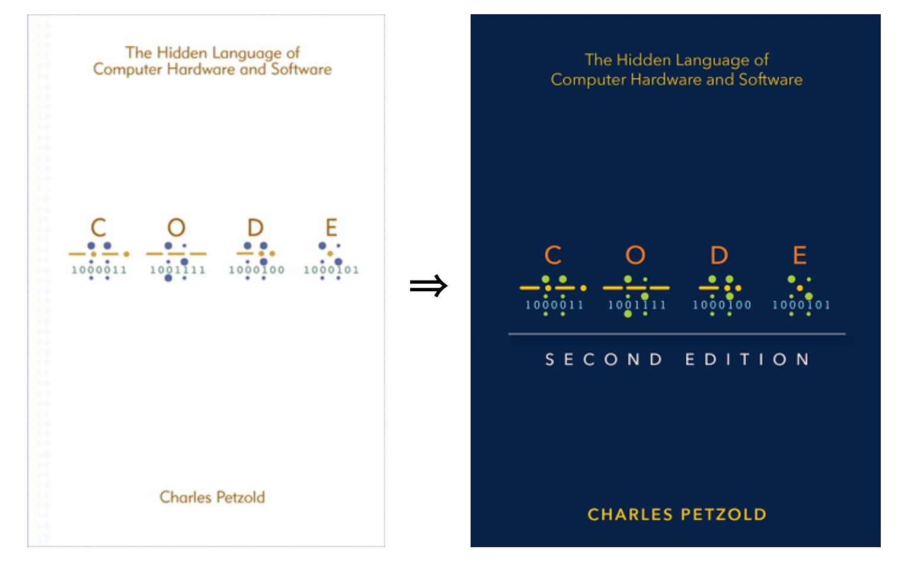

## code-2nd

本项目整理了 Microsoft Press 出版的著作 *Code: The Hidden Language of Computer Hardware and Software, 2nd Edition* 的一些参考资源，包括官方样例 PDF（[Logic with Switches](https://www.microsoftpressstore.com/articles/article.aspx?p=3150377)、[Bit by Bit by Bit](https://www.microsoftpressstore.com/articles/article.aspx?p=3150378)）、勘误表、教材插图，以及本人在阅读学习本书过程中按章节记录、整理的个人笔记。

  

本书讲述的是计算机工作原理。作者用丰富的想象和清晰的笔墨将看似繁杂的理论阐述得通俗易懂，你丝毫不会感到枯燥和生硬。更重要的是，你会因此而获得对计算机工作原理较深刻的理解。这种理解不是抽象层面上的，而是具有一定深度的。新版本编码更深入地探索了每个智能设备核心的逐位逐门构造：中央处理器，它结合了最基本的操作来执行最复杂的任务。关于第二版和第一版详细的区别，请访问作者的这篇[博客](https://www.charlespetzold.com/blog/2022/09/The-Changes-for-the-2nd-Edition-of-Code.html)获取更多信息。

除了大幅修订和更新的内容外，作者 *Charles Petzold* 还创建了一个[交互式网站](https://codehiddenlanguage.com/)，该网站使用动画交互图形使计算机更容易理解。另外，新版书籍标志性的封面仍然以盲文、摩尔斯电码和 ASCII 码的形式展示着 "CODE" 这几个字母。

另：若本项目对您有所帮助，请在页面右上角点个 Star ⭐ 支持一下，谢谢！

## 勘误

如发现书中内容有误，可通过以下渠道反馈：

- **Microsoft Press 官方勘误页**：[https://www.microsoftpressstore.com/contact-us/errata](https://www.microsoftpressstore.com/contact-us/errata)
- **联系作者**：[cp@charlespetzold.com](mailto:cp@charlespetzold.com)

此外，本仓库的[勘误表](勘误表)目录中收录了 Microsoft Press 发布的官方勘误文档，可供参考。为保持官方文档的原貌，尚未被 Microsoft Press 收录、但已由其他权威来源确认的问题，将暂列在下方的“社区补充勘误”中。

### 社区补充勘误

| 版本与位置 | 问题 | 更正 | 确认状态 |
| --- | --- | --- | --- |
| 中文第 2 版第 312 页第 2 张图；英文第 2 版第 367 页下方对应图；[官网 Chapter 23 综合电路图](https://codehiddenlanguage.com/Chapter23) | 生成 `2-Cycle Execute` 信号的 OR 门遗漏了来自 `INX HL` 和 `DCX HL` 的两路输入，导致这两条指令被错误归入 `1-Cycle Execute`。 | 将 `INX HL` 和 `DCX HL` 接入该 OR 门，使两条指令按 `EC1 → EP1 → EC2 → EP2` 完成两个执行周期。 | 机械工业出版社联系译者后确认此处确有问题，并表示中文版重印时将修正；Microsoft Press 或英文原作者尚未确认。详见 [Issue #2](https://github.com/ascendho/code-2nd/issues/2#issuecomment-6184691724)。 |

感谢 [@yudabao8](https://github.com/yudabao8) 发现并认真核验上述问题，同时向出版社提交反馈并同步确认结果。

## 许可

本仓库中由 [@ascendho](https://github.com/ascendho) 原创的文字内容采用 [CC BY-NC-SA 4.0](https://creativecommons.org/licenses/by-nc-sa/4.0/) 许可，允许在署名、非商业和相同方式共享的条件下转载及改编。

官方样例 PDF、官方勘误、教材插图、书籍封面以及其他第三方材料不适用该许可证，其版权及相关权利归原作者、出版社或其他相应权利人所有。具体许可范围与第三方材料清单请参阅 [LICENSE](LICENSE) 和 [NOTICE.md](NOTICE.md)。

> [!IMPORTANT]
>
> 本仓库收录、引用或展示第三方材料不表示维护者拥有其版权，也不授予任何额外使用权。使用者应自行确认并遵守相应权利人的许可条款及适用法律。若本仓库内容影响到您的权益，请联系<a href="mailto:ascendho@outlook.com">本人</a>，将及时处理。
